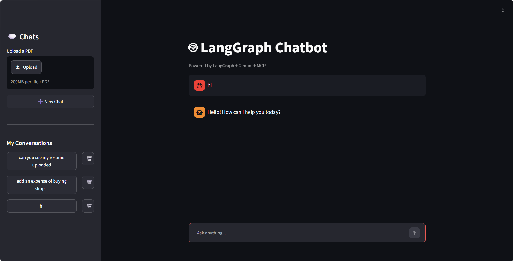
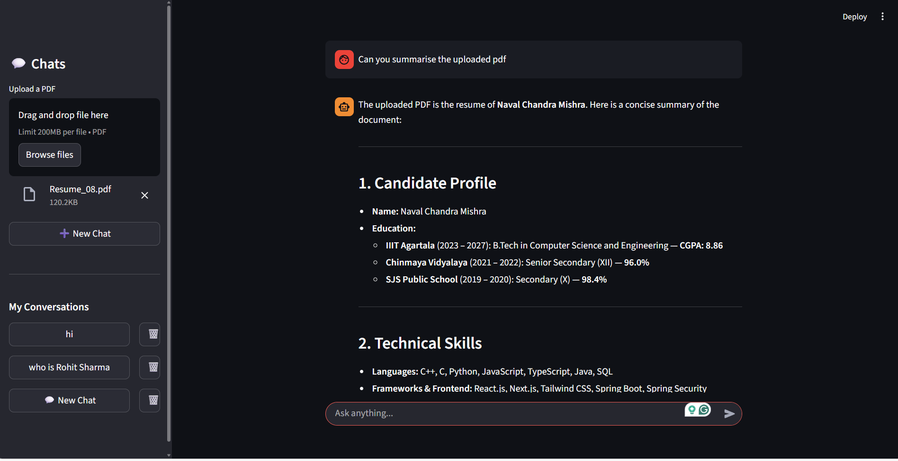
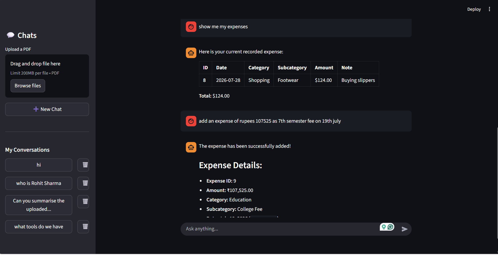

# 🤖 Agentic AI Assistant

A production-ready **Agentic AI Assistant** built with **LangGraph**, **Streamlit**, and **Google Gemini**, featuring persistent memory, Retrieval-Augmented Generation (RAG), Model Context Protocol (MCP) tools, streaming responses, and multi-conversation support.


---

## 🚀 Features

### 💬 Intelligent Chat
- Natural conversational AI powered by **Gemini**
- Real-time streaming responses
- Multi-turn conversations
- Context-aware replies

### 🧠 Persistent Memory
- SQLite-based conversation persistence
- Multiple chat threads
- Resume conversations anytime
- Automatic chat history management

### 📚 Retrieval-Augmented Generation (RAG)
- Upload and query documents
- FAISS vector database
- HuggingFace embeddings
- Semantic search
- Context-aware document answering

### 🔧 MCP Tool Integration
- Model Context Protocol (MCP)
- External tool execution
- Modular tool architecture
- Easy addition of custom MCP servers

### 🌐 Web Interface
- Modern Streamlit UI
- Sidebar conversation manager
- Create/Delete chat sessions
- Live streaming responses

### ⚡ Production Ready
- LangGraph workflow orchestration
- SQLite checkpointing
- Railway deployment
- Modular architecture
- Environment variable support

---

# 🏗️ Architecture

```
                   ┌───────────────┐
                   │   Streamlit   │
                   │      UI       │
                   └───────┬───────┘
                           │
                           ▼
                  LangGraph Workflow
                           │
          ┌────────────────┼────────────────┐
          │                │                │
          ▼                ▼                ▼
      Gemini LLM         RAG           MCP Tools
          │                │                │
          └────────────────┼────────────────┘
                           │
                           ▼
                 SQLite Persistence
```

---

# 🛠️ Tech Stack

| Category | Technologies |
|----------|--------------|
| LLM | Google Gemini |
| Agent Framework | LangGraph |
| LLM Framework | LangChain |
| Frontend | Streamlit |
| Vector Store | FAISS |
| Embeddings | HuggingFace Sentence Transformers |
| Persistence | SQLite |
| MCP | LangChain MCP Adapters |
| Deployment | Railway |

---

# 📂 Project Structure

```
Agentic-AI-Assistant/
│
├── frontend.py
├── langgraph_mcp_backend.py
├── database_backend.py
│
├── rag/
│   ├── embeddings.py
│   ├── vector_store.py
│   ├── loader.py
│   └── retriever.py
│
├── database/
│
├── chatbot.db
├── requirements.txt
├── .env
└── README.md
```

---

# ⚙️ Installation

## Clone Repository

```bash
git clone https://github.com/navalmishra/Agentic-AI-Assistant.git
cd Agentic-AI-Assistant
```

## Create Virtual Environment

```bash
python -m venv venv
```

### Windows

```bash
venv\Scripts\activate
```

### Linux / Mac

```bash
source venv/bin/activate
```

## Install Dependencies

```bash
pip install -r requirements.txt
```

---

# 🔑 Environment Variables

Create a `.env` file.

```env
GOOGLE_API_KEY=YOUR API KEY
LANGSMITH_API_KEY=YOUR API KEY
LANGCHAIN_TRACING_V2=true
LANGCHAIN_PROJECT=Chatbot-Project [YOUR PROJECT NAME]
LANGCHAIN_ENDPOINT=https://api.smith.langchain.com
TAVILY_API_KEY=YOUR API KEY
```

---

# ▶️ Run Locally

```bash
streamlit run frontend.py
```

---

# 🌍 Deployment

This project is deployed on **Railway**.

Deployment includes:

- Streamlit UI
- SQLite Persistence
- LangGraph Agent
- RAG
- MCP Tools
- HITL
- LangSmith Monitoring

---

# 🧠 Workflow

```text
User
 │
 ▼
Streamlit UI
 │
 ▼
LangGraph Agent
 │
 ├── Normal Chat
 ├── RAG Retrieval
 ├── MCP Tool Call
 └── Memory Lookup
 │
 ▼
Gemini Response
 │
 ▼
Streaming Output
```

---

# 📸 Screenshots

Add screenshots here.

Example:

# 📸 Screenshots

## 🏠 Home Interface



---

## 📚 RAG Demo



---

## 🔧 MCP Tools



---

# 🔮 Future Improvements

- User Authentication
- Cloud Database
- Long-Term User Memory
- Voice Assistant
- Multi-Agent Collaboration
- Docker Support
- Kubernetes Deployment

---

# 🤝 Contributing

Contributions are welcome!

1. Fork the repository
2. Create your feature branch
3. Commit your changes
4. Push to your branch
5. Open a Pull Request

---

# 📄 License

This project is licensed under the MIT License.

---

# ⭐ Support

If you found this project helpful, please consider giving it a ⭐ on GitHub.